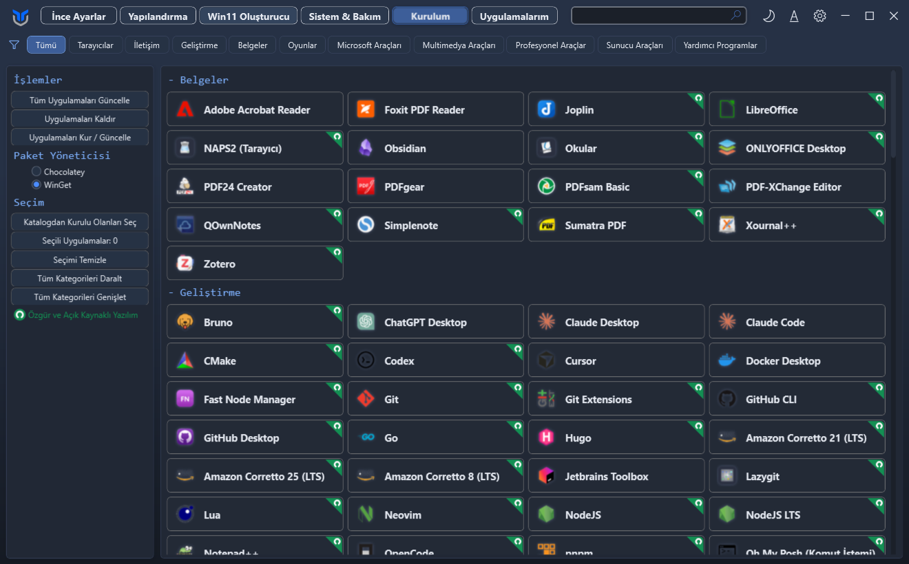
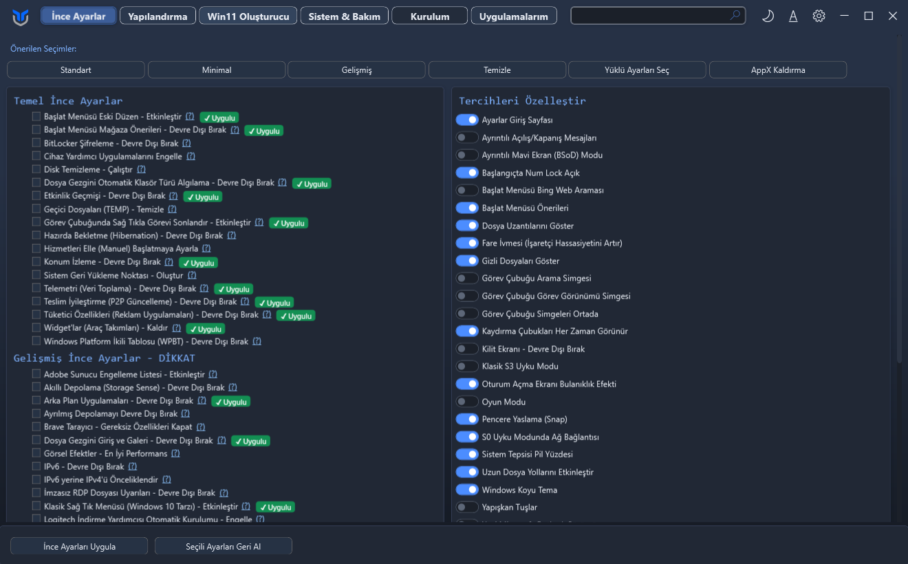
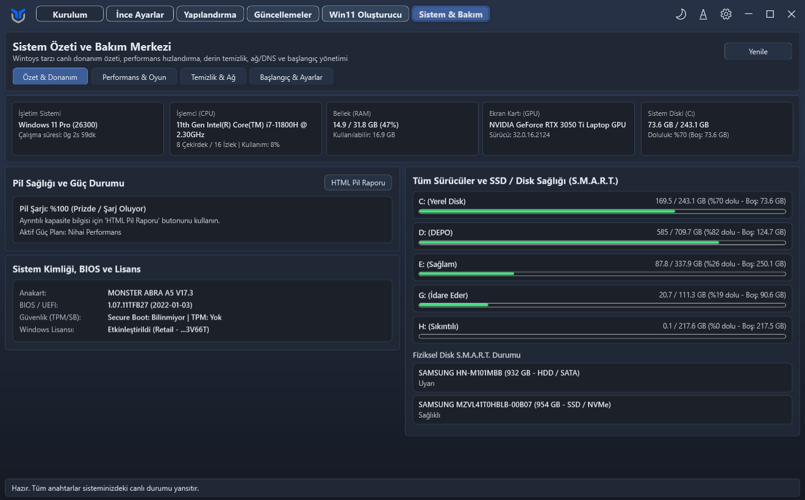
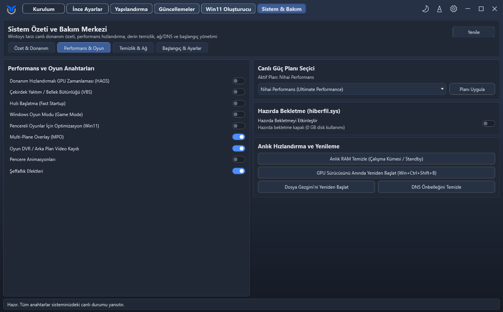
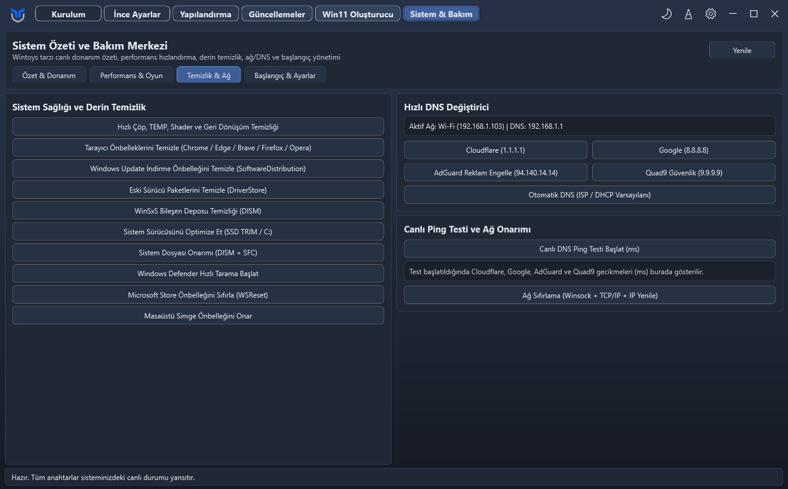
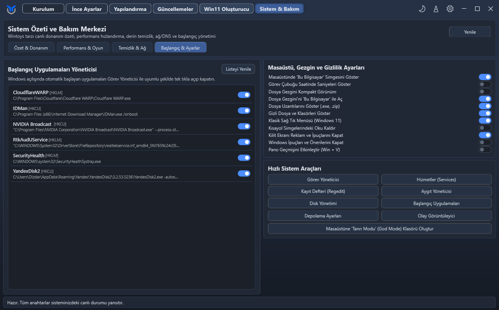
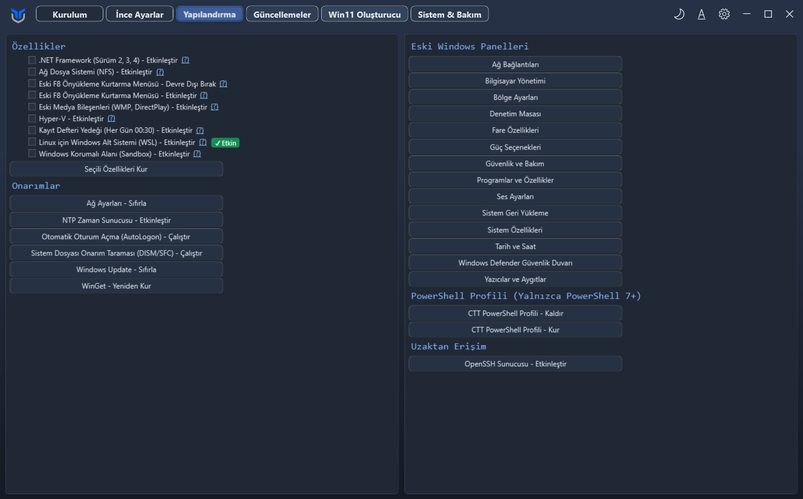
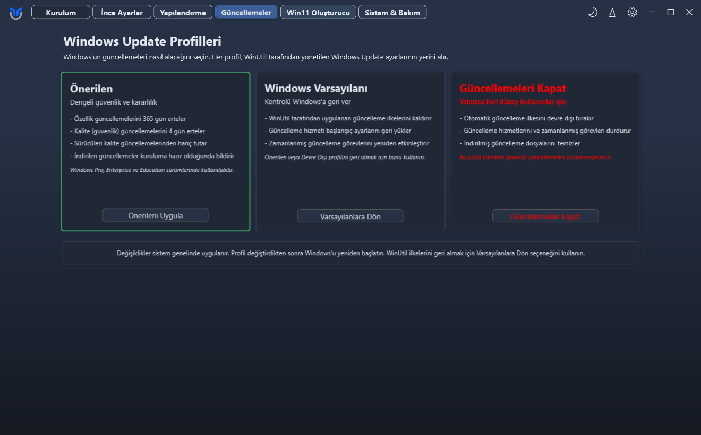
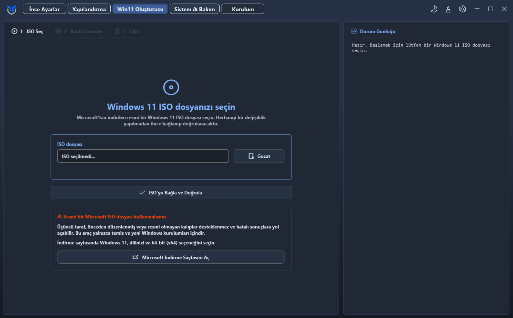
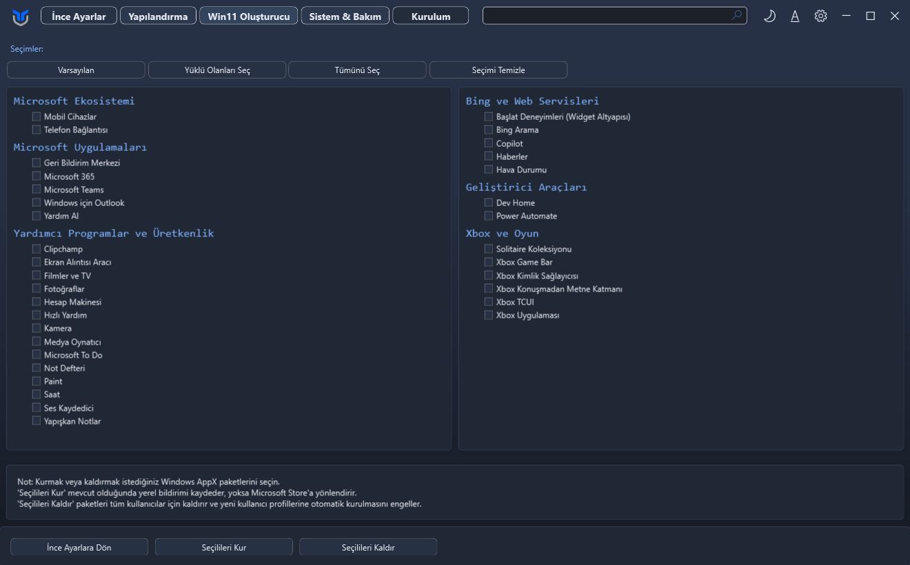

# WinUtil Türkçe

[](https://github.com/edizdar/winutil-tr/releases/latest)
[](#hızlı-başlangıç)
[](#öne-çıkan-özellikler)
[](LICENSE)

**WinUtil Türkçe**; Windows 10 ve Windows 11 sistemlerde toplu uygulama kurulumu (**240+ uygulama**), gizlilik ve performans ince ayarları, **4 alt sekmeli Wintoys tarzı Sistem & Bakım merkezi** (canlı donanım/pil/S.M.A.R.T., oyun boost, derin temizlik, DNS+ping, başlangıç yöneticisi), sistem onarımı, Windows Update profil yönetimi ve özel Windows 11 kurulum kalıbı (**ISO / USB**) oluşturma işlemlerini tek bir **Türkçe / İngilizce** arayüzde toplayan açık kaynaklı araçtır.

> **Hazırlayan:** Erol Dizdar — [https://www.eroldizdar.tr/](https://www.eroldizdar.tr/)  
> **Esinlenme:** [ChrisTitusTech / winutil](https://github.com/christitustech/winutil) · **Sürüm Geçmişi:** [CHANGELOG.md](CHANGELOG.md)

---

## Hızlı Başlangıç

### Yöntem 1: PowerShell Tek Satır Komutu *(İndirme Gerektirmez)*
Herhangi bir Windows 10/11 bilgisayarda **PowerShell**'i açın ve aşağıdaki komutu çalıştırın *(yönetici izni otomatik istenir)*:

```powershell
irm https://raw.githubusercontent.com/edizdar/winutil-tr/main/winutil.ps1 | iex
```

### Yöntem 2: Tek Dosya `.exe` *(Taşınabilir)*
1. **[Releases sayfasından en son `WinUtil-TR.exe` sürümünü](https://github.com/edizdar/winutil-tr/releases/latest)** indirin ve çift tıklayın.
2. Windows Yönetici İzni (UAC) penceresinde **Evet** deyin — siyah konsol penceresi açılmadan doğrudan arayüz başlar.
3. Canlı konsol çıktısını da görmek isterseniz komut satırından `.\WinUtil-TR.exe -Console` şeklinde başlatabilirsiniz.

---

## Ekran Görüntüleri

### 📦 Kurulum (240+ Uygulama, Kategori Filtreleri ve `#FOSS` Rozeti)


### ⚙️ İnce Ayarlar (Otomatik `✓ Uygulu` Rozetleri ve Canlı Sistem Tercihleri)


### 🩺 Sistem & Bakım — Özet & Donanım (Canlı Pil, BIOS/Lisans ve S.M.A.R.T. Disk Sağlığı)


<details>
<summary><strong>Diğer tüm sekmelerin ve alt sekmelerin ekran görüntülerini aç (7 ekran görüntüsü daha)</strong></summary>

#### ⚡ Sistem & Bakım — Performans & Oyun (Boost, Güç Planı, RAM Temizleme, Hiberfil, MPO)


#### 🧹 Sistem & Bakım — Temizlik & Ağ (Tarayıcı/DriverStore/WinSxS Temizliği, Hızlı DNS & Ping)


#### 🚀 Sistem & Bakım — Başlangıç & Ayarlar (Canlı Startup Yöneticisi, 11 Hızlı Ayar ve God Mode)


#### 🛠️ Yapılandırma (`✓ Etkin` Özellikler, Onarım Araçları ve Klasik Paneller)


#### 🔄 Güncellemeler (Windows Update Profilleri)


#### 💿 Win11 Oluşturucu (Özel Bloatware'siz Windows 11 ISO / USB)


#### 📱 AppX Yönetimi (Yerleşik Microsoft Store Uygulamaları)


</details>

---

## Dokümantasyon Rehberi

Her sekmenin ve ayarın ne işe yaradığını ayrıntılı olarak aşağıdaki rehberlerde bulabilirsiniz:

| Rehber | Kapsam |
| :--- | :--- |
| **[📦 Kurulum (Install) Rehberi](rehber/kurulum.md)** | 240 popüler uygulamanın (Wintoys dahil) tek tıkla kurulumu, güncellenmesi, kaldırılması, WinGet/Chocolatey ve kategori listesi. |
| **[⚙️ İnce Ayarlar (Tweaks) Rehberi](rehber/ince-ayarlar.md)** | Standart/Minimal/Gelişmiş profiller, 69 ince ayar ve sistem tercihinin tam açıklaması, DNS seçimi ve geri alma. |
| **[🛠️ Yapılandırma ve Güncellemeler](rehber/yapilandirma-ve-guncellemeler.md)** | Windows özellikleri (WSL, Hyper-V, .NET, Sandbox), sistem/ağ/update onarımları, eski paneller ve Windows Update profilleri. |
| **[💿 Win11 Oluşturucu Rehberi](rehber/win11-olusturucu.md)** | Resmi Windows 11 ISO'sundan bloatware'siz, TPM/Microsoft hesabı engelsiz özel kurulum ISO'su veya format USB'si hazırlama. |
| **[🩺 Sistem & Bakım (Wintoys Tarzı)](rehber/sistem-ve-bakim.md)** | 4 alt sekmeli kapsamlı merkez: Canlı donanım/pil/BIOS/lisans/S.M.A.R.T., 9 oyun/performans anahtarı, güç planı, RAM temizleme, 10 temizlik aracı, hızlı DNS+ping, canlı Startup yöneticisi ve God Mode. |
| **[📱 AppX Yönetimi Rehberi](rehber/appx-yonetimi.md)** | Windows ile yüklü gelen 34 Microsoft Store uygulamasının açıklamaları, güvenli kaldırma ve yeniden kurma rehberi. |
| **[❓ Sık Sorulan Sorular (SSS)](rehber/sss.md)** | Yönetici izni, SmartScreen uyarısı, geri alma, İçe/Dışa Aktar, komut satırı parametreleri, çift dil ve günlük dosyaları. |

---

## Öne Çıkan Özellikler

- **4 Alt Sekmeli Wintoys Tarzı Sistem & Bakım Merkezi:**
  - **Özet & Donanım:** Canlı OS/CPU/RAM/GPU/Disk kartları, **Pil Sağlığı % + HTML Rapor**, Anakart/BIOS/Secure Boot/TPM/Lisans kimliği ve tüm sürücülerin **S.M.A.R.T.** sağlığı.
  - **Performans & Oyun:** HAGS, VBS, Fast Startup, Oyun Modu, Pencereli Oyun Optimizasyonu (Win11), MPO, Oyun DVR, Animasyonlar, Şeffaflık, **Canlı Güç Planı Seçici**, `hiberfil.sys` yönetimi, **Anlık RAM Temizleme** ve **GPU Sürücü Yenileme**.
  - **Temizlik & Ağ:** Hızlı TEMP/Shader, **Tarayıcı Önbellek Temizleyici** (şifre/oturum korunur), **Windows Update Önbellek**, **Eski Sürücü Temizliği (`DriverStore`)**, WinSxS, SSD TRIM, DISM+SFC, Defender, WSReset, **Simge Önbelleği Onarımı**, **Tek Tıkla DNS Değiştirici** (Cloudflare/Google/AdGuard/Quad9/Otomatik), **Canlı Ping Testi** ve **Ağ Sıfırlama**.
  - **Başlangıç & Ayarlar:** Görev Yöneticisi uyumlu **Canlı Başlangıç Uygulamaları Yöneticisi**, 11 hızlı masaüstü/gezgin/gizlilik anahtarı, 8 sistem aracı ve **Tanrı Modu (God Mode)** oluşturucu.
- **Çift Dil Desteği (Türkçe / English + Otomatik Algılama):** Windows sistem dili Türkçe olan bilgisayarlarda otomatik **Türkçe**, diğer tüm sistem dillerinde otomatik **English** açılır. Sağ üstteki **Ayarlar (⚙️)** menüsünden yeniden başlatmadan anında dil değiştirebilirsiniz.
- **%100 Türkçe Arayüz ve Açıklamalar:** Tüm sekmeler, butonlar, diyaloglar, 240 uygulama açıklaması (Wintoys dahil), 69 ince ayar, 33 özellik/onarım ve 34 AppX açıklaması Türkçedir.
- **Canlı Sistem Durumu Rozetleri:** Hangi bilgisayarda açılırsa o sistemi arka planda otomatik tarar:
  - **İnce Ayarlar** sekmesinde zaten uygulanmış ayarların yanında **`✓ Uygulu`**
  - **Yapılandırma** sekmesinde etkin Windows özelliklerinin yanında **`✓ Etkin`**
  - **AppX** sekmesinde kurulu uygulamaların yanında **`✓ Kurulu`** etiketi görünür.
- **Güvenli Seçim Mantığı & Tek Dosya Taşınabilir `.exe`:** İşaretlemediğiniz hiçbir ayar değiştirilmez; ek runtime kurulumu gerekmeden yerleşik .NET Framework 4.8 ile çalışır.

---

## Kaynaktan Derleme

Kodlarda değişiklik yaptıktan sonra `winutil.ps1` ve `WinUtil-TR.exe` dosyalarını yeniden derlemek için:

```powershell
powershell -NoProfile -ExecutionPolicy Bypass -File .\Build-Exe.ps1
```

Sürüm numarası **[VERSION](VERSION)** dosyasından okunur; her yeni sürümde bu dosya güncellenerek hem uygulama içi **Hakkında** ekranı hem de `.exe` dosya özellikleri otomatik güncellenir. Tüm sürümlerin ayrıntılı geçmişi için **[CHANGELOG.md](CHANGELOG.md)** dosyasına göz atabilirsiniz.

## Lisans

Bu proje orijinal [MIT Lisansı](LICENSE) altında sunulmaktadır.
