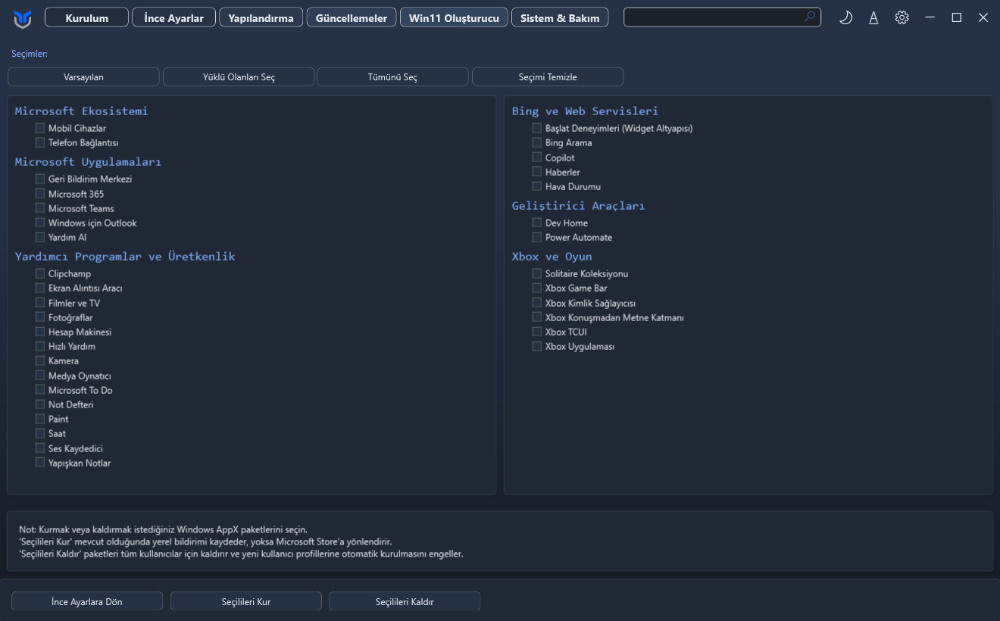

[🏠 Ana Sayfa](../README.md) · [📦 Kurulum](kurulum.md) · [⚙️ İnce Ayarlar](ince-ayarlar.md) · [🛠️ Yapılandırma & Güncellemeler](yapilandirma-ve-guncellemeler.md) · [💿 Win11 Oluşturucu](win11-olusturucu.md) · [🩺 Sistem & Bakım](sistem-ve-bakim.md) · [📱 AppX Yönetimi](appx-yonetimi.md) · [❓ SSS](sss.md)

# 📱 AppX (Yerleşik Windows Uygulamaları) Yönetimi Rehberi

**İnce Ayarlar** sekmesindeki **AppX Kaldırma** butonuna tıklayarak ulaşabileceğiniz bu ekran, Windows ile önceden yüklü gelen Microsoft Store (AppX) uygulamalarını toplu olarak **kaldırmanızı** veya gerektiğinde **yeniden kurmanızı** sağlar.

## Temel Bilgiler

- **Otomatik `✓ Kurulu` Rozeti:** Sekme açıldığında bilgisayarınızda hâlihazırda kurulu olan yerleşik uygulamalar taranır ve yanlarında yeşil **`✓ Kurulu`** etiketi gösterilir.
- **Varsayılan Seçim:** Üstteki **Varsayılan** butonu, çoğu kullanıcının kaldırmasında sakınca olmayan gereksiz uygulamaları (Geri Bildirim Merkezi, Clipchamp, Haberler, Copilot, Bing Arama vb.) otomatik seçer.
- **Seçilileri Kaldır:** Seçtiğiniz uygulamaları **tüm kullanıcılar** için kaldırır ve yeni kullanıcı hesaplarına otomatik yüklenmesini engeller.
- **Seçilileri Kur:** Daha önce kaldırdığınız bir uygulamaya tekrar ihtiyaç duyarsanız (ör. Hesap Makinesi, Fotoğraflar, Ekran Alıntısı Aracı) seçip **Seçilileri Kur** ile geri getirebilirsiniz.

> ⚠️ **Dikkat Edilmesi Gereken Paketler:** **Xbox Kimlik Sağlayıcısı** ve **Xbox TCUI** paketlerini kaldırmak, Xbox uygulaması dışındaki bazı Microsoft Store oyunlarında veya uygulamalarında Microsoft hesabıyla oturum açmayı bozabilir. Emin değilseniz bu ikisini kaldırmamanız önerilir.

## Tüm Yerleşik AppX Uygulamaları (34 Adet)

### Bing ve Web Servisleri

| Uygulama | Varsayılan Kaldırmada Var mı? | Açıklama |
| :--- | :---: | :--- |
| **Başlat Deneyimleri (Widget Altyapısı)** | ✅ Evet | Windows Widget panosunu çalıştırarak haber, hava durumu, spor ve finans akışları sunar. |
| **Bing Arama** | ✅ Evet | Microsoft Bing arama özelliklerini ve web servislerini doğrudan işletim sistemine entegre eder. |
| **Copilot** | ✅ Evet | Bağlamsal yanıtlar, yazı desteği ve akıllı web araması için Microsoft yapay zeka asistanı. |
| **Haberler** | ✅ Evet | Son dakika haber başlıklarını, kişiselleştirilmiş makale akışlarını ve gündemi gösterir. |
| **Hava Durumu** | ✅ Evet | Yerel canlı hava durumu, radar haritaları ve hava tahminlerini görüntüler. |

### Geliştirici Araçları

| Uygulama | Varsayılan Kaldırmada Var mı? | Açıklama |
| :--- | :---: | :--- |
| **Dev Home** | ✅ Evet | Yazılım geliştiricileri için ortam kurulumu, depo eşitleme ve donanım araçları sunan kontrol paneli. |
| **Power Automate** | ✅ Evet | Görsel akışlarla tekrarlayan masaüstü görevlerini otomatikleştirir. |

### Microsoft Ekosistemi

| Uygulama | Varsayılan Kaldırmada Var mı? | Açıklama |
| :--- | :---: | :--- |
| **Mobil Cihazlar** | — | Eşleştirilmiş mobil cihazlarla arka plan bağlantısını yönetir. Kaldırılması telefon ekranı yansıtma, dosya aktarımı ve mobil erişim noktası özelliklerini devre dışı bırakabilir. |
| **Telefon Bağlantısı** | — | Mobil cihazınızdaki SMS'leri, bildirimleri, fotoğrafları ve aramaları bilgisayarla eşitler. |

### Microsoft Uygulamaları

| Uygulama | Varsayılan Kaldırmada Var mı? | Açıklama |
| :--- | :---: | :--- |
| **Geri Bildirim Merkezi** | ✅ Evet | Hata raporları, özellik önerileri ve tanılama verilerini doğrudan Microsoft'a göndermeye yarar. |
| **Microsoft 365** | ✅ Evet | Bulut tabanlı Microsoft 365 uygulamalarına ve son belgelere erişmek için merkezi başlatıcı. |
| **Microsoft Teams** | — | Anlık mesajlaşma, görüntülü toplantı, dosya paylaşımı ve ekip içi iş birliği sağlar. |
| **Windows için Outlook** | — | Modern e-posta yönetimi, takvim planlama ve kişi düzenleme özellikleri sunar. |
| **Yardım Al** | ✅ Evet | Otomatik sorun giderme rehberleri, destek belgeleri ve Microsoft müşteri desteğine erişim sağlar. |

### Xbox ve Oyun

| Uygulama | Varsayılan Kaldırmada Var mı? | Açıklama |
| :--- | :---: | :--- |
| **Solitaire Koleksiyonu** | ✅ Evet | Klondike, Spider, FreeCell, Pyramid ve TriPeaks kart oyunlarını içerir. |
| **Xbox Game Bar** | — | Oyun içi durum araçları, ses karıştırıcı, sistem izleme ve oyun kaydı özellikleri sunar. |
| **Xbox Kimlik Sağlayıcısı** | — | Xbox ağı kullanıcı oturum açma ve hesap doğrulamasını yönetir. Uyarı: Kaldırılması bazı oyun ve uygulamalarda Microsoft hesabı ile giriş yapmayı bozabilir. |
| **Xbox Konuşmadan Metne Katmanı** | — | Oyun sohbetleri için canlı erişilebilirlik altyazıları ve sesten metne çeviri sağlar. |
| **Xbox TCUI** | — | Oyunlarda tek oturum açma (SSO) arayüz bileşenlerini sağlar. Uyarı: Kaldırılması Xbox uygulaması gerektirmeyen oyun ve uygulamalarda Microsoft hesabı doğrulamasını bozabilir. |
| **Xbox Uygulaması** | — | Oyun kütüphanesi yöneticisi, topluluk arayüzü ve PC Game Pass kontrol paneli. |

### Yardımcı Programlar ve Üretkenlik

| Uygulama | Varsayılan Kaldırmada Var mı? | Açıklama |
| :--- | :---: | :--- |
| **Clipchamp** | ✅ Evet | Hazır şablonlar, efektler ve zaman çizelgesi araçlarıyla kullanıcı dostu video düzenleyici. |
| **Ekran Alıntısı Aracı** | — | İşaretleme, kırpma ve metin tanıma (OCR) özellikleriyle ekran görüntüsü ve ekran kaydı alır. |
| **Filmler ve TV** | — | Varsayılan video oynatıcı ve medya kiralama/satın alma mağazası. |
| **Fotoğraflar** | — | Yerel görselleri düzenler, görüntüler, kırpar ve temel renk ayarları yapar. |
| **Hesap Makinesi** | ✅ Evet | Standart, bilimsel, programcı hesaplamaları ve birim dönüştürme işlemleri yapar. |
| **Hızlı Yardım** | ✅ Evet | İnternet üzerinden güvenli uzaktan teknik destek ve ekran paylaşımı sağlar. |
| **Kamera** | — | Bağlı web kameraları üzerinden fotoğraf çeker ve video kaydeder. |
| **Medya Oynatıcı** | — | Yerel ses ve video dosyalarını modern çalma listesi yönetimiyle oynatır. |
| **Microsoft To Do** | ✅ Evet | Kişisel görevler, akıllı listeler ve günlük hatırlatıcılar oluşturup eşitler. |
| **Not Defteri** | — | Düz metin dosyaları ve kod parçacıkları için çok sekmeli hafif metin düzenleyici. |
| **Paint** | — | Yerleşik dijital çizim ve temel görsel düzenleme aracı. |
| **Saat** | ✅ Evet | Dünya saatleri, alarmlar, geri sayım sayaçları, kronometre ve odak oturumları içerir. |
| **Ses Kaydedici** | ✅ Evet | Mikrofondan canlı ses kaydı yapar ve temel kırpma işlemleri sunar. |
| **Yapışkan Notlar** | ✅ Evet | Masaüstünde hızlı, cihazlar arası eşitlenen yapışkan metin notları oluşturur. |

---

[🏠 Ana Sayfa](../README.md) · [📦 Kurulum](kurulum.md) · [⚙️ İnce Ayarlar](ince-ayarlar.md) · [🛠️ Yapılandırma & Güncellemeler](yapilandirma-ve-guncellemeler.md) · [💿 Win11 Oluşturucu](win11-olusturucu.md) · [🩺 Sistem & Bakım](sistem-ve-bakim.md) · [📱 AppX Yönetimi](appx-yonetimi.md) · [❓ SSS](sss.md)
