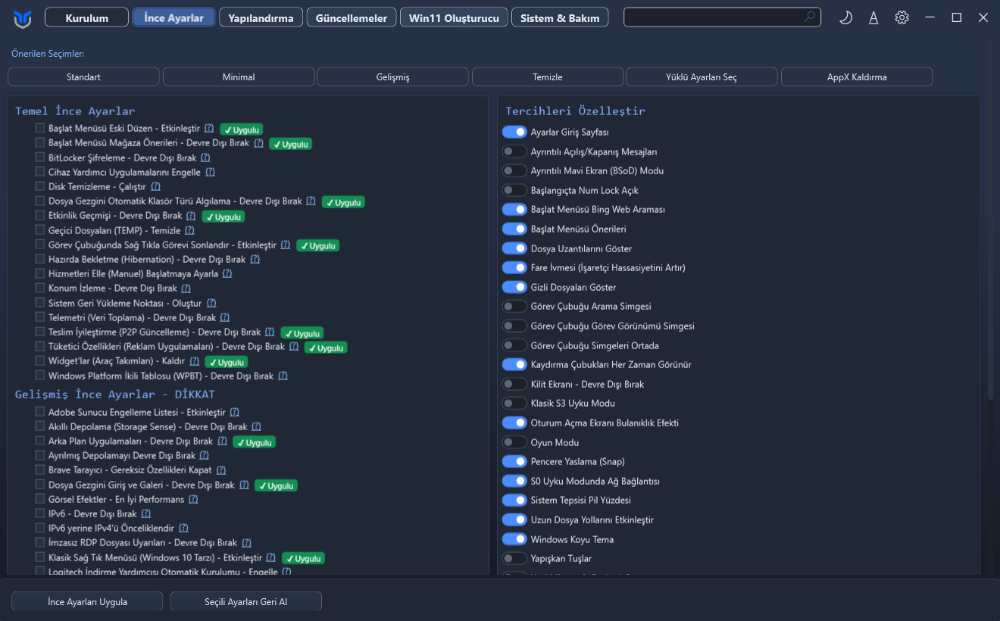

[🏠 Ana Sayfa](../README.md) · [📦 Kurulum](kurulum.md) · [⚙️ İnce Ayarlar](ince-ayarlar.md) · [🛠️ Yapılandırma & Güncellemeler](yapilandirma-ve-guncellemeler.md) · [💿 Win11 Oluşturucu](win11-olusturucu.md) · [🩺 Sistem & Bakım](sistem-ve-bakim.md) · [📱 AppX Yönetimi](appx-yonetimi.md) · [❓ SSS](sss.md)

# ⚙️ İnce Ayarlar (Tweaks) Sekmesi Rehberi

**İnce Ayarlar** sekmesi; Windows'un gereksiz arka plan telemetrisini kapatmak, sistem performansını artırmak, gizliliği güçlendirmek ve görünüm tercihlerini özelleştirmek için kullanılır.

## Nasıl Çalışır? (Güvenli Kullanım)

- **Otomatik `✓ Uygulu` Rozeti:** Sekme açıldığında bilgisayarınız arka planda otomatik taranır. Daha önce uyguladığınız ince ayarların yanında yeşil **`✓ Uygulu`** etiketi görünür.
- **İşaretlemediklerinize Dokunmaz:** Kutucuğunu işaretlemediğiniz hiçbir ayar değiştirilmez veya geri alınmaz. Yalnızca işaretleyip **İnce Ayarları Uygula** (veya **Seçili Ayarları Geri Al**) dediğiniz öğeler işlenir.
- **Geri Alma Desteği:** Uygulanmış bir ince ayarı geri almak için kutucuğunu işaretleyip alttaki **Seçili Ayarları Geri Al** butonuna tıklamanız yeterlidir.
- **Sistem Geri Yükleme Noktası:** Değişiklik yapmadan önce **Sistem Geri Yükleme Noktası - Oluştur** seçeneğini işaretlemeniz önerilir.

## Hazır Profiller (Önerilen Seçimler)

| Profil | Kime Göre? |
| :--- | :--- |
| **Standart** | Çoğu ev ve ofis kullanıcısı için en güvenli, dengeli optimizasyon seti. |
| **Minimal** | Sisteme en az müdahale ederek yalnızca temel telemetri, tüketici reklamları ve gereksiz servisleri düzenler. |
| **Gelişmiş** | Standart ayarlara ek olarak OneDrive kaldırma, Windows AI/Copilot kaldırma, Widget kaldırma ve klasik sağ tık menüsünü de içerir. |

<strong>Profillerin içerdiği ayarları gör</strong>

### Standart Profil
- Etkinlik Geçmişi - Devre Dışı Bırak
- Tüketici Özellikleri (Reklam Uygulamaları) - Devre Dışı Bırak
- Dosya Gezgini Otomatik Klasör Türü Algılama - Devre Dışı Bırak
- Windows Platform İkili Tablosu (WPBT) - Devre Dışı Bırak
- Konum İzleme - Devre Dışı Bırak
- Hizmetleri Elle (Manuel) Başlatmaya Ayarla
- Telemetri (Veri Toplama) - Devre Dışı Bırak
- Teslim İyileştirme (P2P Güncelleme) - Devre Dışı Bırak
- Disk Temizleme - Çalıştır
- Geçici Dosyaları (TEMP) - Temizle
- Görev Çubuğunda Sağ Tıkla Görevi Sonlandır - Etkinleştir
- Sistem Geri Yükleme Noktası - Oluştur

### Minimal Profil
- Tüketici Özellikleri (Reklam Uygulamaları) - Devre Dışı Bırak
- Windows Platform İkili Tablosu (WPBT) - Devre Dışı Bırak
- Hizmetleri Elle (Manuel) Başlatmaya Ayarla
- Telemetri (Veri Toplama) - Devre Dışı Bırak

### Gelişmiş Profil
- Sistem Geri Yükleme Noktası - Oluştur
- Etkinlik Geçmişi - Devre Dışı Bırak
- Tüketici Özellikleri (Reklam Uygulamaları) - Devre Dışı Bırak
- Dosya Gezgini Otomatik Klasör Türü Algılama - Devre Dışı Bırak
- Windows Platform İkili Tablosu (WPBT) - Devre Dışı Bırak
- Konum İzleme - Devre Dışı Bırak
- Hizmetleri Elle (Manuel) Başlatmaya Ayarla
- Telemetri (Veri Toplama) - Devre Dışı Bırak
- Teslim İyileştirme (P2P Güncelleme) - Devre Dışı Bırak
- Geçici Dosyaları (TEMP) - Temizle
- Görev Çubuğunda Sağ Tıkla Görevi Sonlandır - Etkinleştir
- Başlat Menüsü Mağaza Önerileri - Devre Dışı Bırak
- Başlat Menüsü Eski Düzen - Etkinleştir
- Widget'lar (Araç Takımları) - Kaldır
- Microsoft OneDrive - Kaldır
- Windows Yapay Zeka (AI / Copilot / Recall) - Kaldır ve Kapat
- Klasik Sağ Tık Menüsü (Windows 10 Tarzı) - Etkinleştir

## Tüm İnce Ayarlar ve Tercihler (Ayrıntılı Liste)

### Temel İnce Ayarlar

| Ayar | Tür | Ne İşe Yarar? |
| :--- | :---: | :--- |
| **Başlat Menüsü Eski Düzen - Etkinleştir** | Seçim Kutusu | 25H2 ile gelen yeni düzenden önceki klasik Başlat Menüsü düzenini geri getirir. Daha yeni Windows sürümlerinde ÇALIŞMAYABİLİR! |
| **Başlat Menüsü Mağaza Önerileri - Devre Dışı Bırak** | Seçim Kutusu | Başlat menüsünde arama yaparken önerilen Microsoft Store uygulamalarının gösterilmesini engeller. |
| **BitLocker Şifreleme - Devre Dışı Bırak** | Seçim Kutusu | BitLocker disk şifrelemesini devre dışı bırakır. |
| **Cihaz Yardımcı Uygulamalarını Engelle** | Seçim Kutusu | Yeni donanım (monitör, fare vb.) takıldığında otomatik olarak ek yazılım/reklam kurulmasını engeller. |
| **Disk Temizleme - Çalıştır** | Seçim Kutusu | C: sürücüsünde Disk Temizleme çalıştırır ve eski Windows güncelleme dosyalarını temizler. |
| **Dosya Gezgini Otomatik Klasör Türü Algılama - Devre Dışı Bırak** | Seçim Kutusu | Dosya Gezgini'nin klasör içeriğine göre görünüm tahmin etmesini kapatarak gezinmeyi hızlandırır. UYARI: Klasör gruplamasını kapatır. |
| **Etkinlik Geçmişi - Devre Dışı Bırak** | Seçim Kutusu | Pano geçmişini korurken Windows'un kullanıcı etkinliklerini yayımlamasını ve buluta yüklemesini durdurur. |
| **Geçici Dosyaları (TEMP) - Temizle** | Seçim Kutusu | Sistem ve kullanıcı TEMP klasörlerindeki geçici dosyaları siler. |
| **Görev Çubuğunda Sağ Tıkla Görevi Sonlandır - Etkinleştir** | Seçim Kutusu | Görev çubuğundaki bir programa sağ tıkladığınızda 'Görevi sonlandır' seçeneğini ekler. |
| **Hazırda Bekletme (Hibernation) - Devre Dışı Bırak** | Seçim Kutusu | Hazırda bekletme bilgisayarı kapatırken RAM içeriğini diske yazar ve disk alanı kaplar. Masaüstü bilgisayarlarda kapatılması önerilir. |
| **Hizmetleri Elle (Manuel) Başlatmaya Ayarla** | Seçim Kutusu | Gereksiz arka plan hizmetlerini yalnızca ihtiyaç duyulduğunda çalışacak şekilde 'Elle' başlangıç türüne ayarlar. |
| **Konum İzleme - Devre Dışı Bırak** | Seçim Kutusu | Windows konum izleme servisini devre dışı bırakır. |
| **Sistem Geri Yükleme Noktası - Oluştur** | Seçim Kutusu | WinUtil değişikliklerini gerekirse geri alabilmek için işlem öncesinde bir sistem geri yükleme noktası oluşturur. |
| **Telemetri (Veri Toplama) - Devre Dışı Bırak** | Seçim Kutusu | Microsoft telemetri ve tanılama veri toplama görevlerini devre dışı bırakır. |
| **Teslim İyileştirme (P2P Güncelleme) - Devre Dışı Bırak** | Seçim Kutusu | Windows'un internet bant genişliğinizi kullanarak başka bilgisayarlara güncelleme yüklemesini durdurur. |
| **Tüketici Özellikleri (Reklam Uygulamaları) - Devre Dışı Bırak** | Seçim Kutusu | Sponsorlu uygulama kurulumlarını durdurur ve Microsoft Store içerik önerilerini azaltır. |
| **Widget'lar (Araç Takımları) - Kaldır** | Seçim Kutusu | Görev çubuğunun sol alt köşesindeki rahatsız edici widget'ları kaldırır. |
| **Windows Platform İkili Tablosu (WPBT) - Devre Dışı Bırak** | Seçim Kutusu | Bilgisayar üreticilerinin açılışta kullanıcı izni olmadan yazılım/sürücü çalıştırmasını sağlayan WPBT güvenlik riskini kapatır. |

### Tercihleri Özelleştir

> 💡 **Bilgi:** Bu bölümdeki aç/kapa anahtarları sisteminizin mevcut durumunu otomatik okur ve tıkladığınız anda anında uygulanır.

| Ayar | Tür | Ne İşe Yarar? |
| :--- | :---: | :--- |
| **Ayarlar Giriş Sayfası** | Aç/Kapa | Windows Ayarlar uygulamasındaki Giriş sayfasını gösterir veya gizler. |
| **Ayrıntılı Açılış/Kapanış Mesajları** | Aç/Kapa | Windows başlatılırken ve kapatılırken ayrıntılı durum mesajları gösterir. |
| **Ayrıntılı Mavi Ekran (BSoD) Modu** | Aç/Kapa | Mavi ekran hatası oluştuğunda daha fazla teknik bilgi gösterir. |
| **Başlangıçta Num Lock Açık** | Aç/Kapa | Bilgisayar açıldığında Num Lock tuşunun otomatik açık olmasını sağlar. |
| **Başlat Menüsü Bing Web Araması** | Aç/Kapa | Windows Arama'daki Bing web arama sonuçlarını açar veya kapatır. |
| **Başlat Menüsü Önerileri** | Aç/Kapa | Başlat Menüsü'ndeki Önerilenler bölümünü açar/kapatır. UYARI: Kilit ekranındaki Windows Spot Işığı özelliğini de devre dışı bırakır. |
| **Dosya Uzantılarını Göster** | Aç/Kapa | Dosya Gezgini'nde dosya uzantılarını (.exe, .png vb.) görünür yapar. |
| **Fare İvmesi (İşaretçi Hassasiyetini Artır)** | Aç/Kapa | İmleç hareketinin farenin fiziksel hareket hızından etkilenmesini açar/kapatır. |
| **Gizli Dosyaları Göster** | Aç/Kapa | Dosya Gezgini'nde gizli dosya ve klasörleri gösterir. |
| **Görev Çubuğu Arama Simgesi** | Aç/Kapa | Görev çubuğundaki Arama düğmesini gösterir veya gizler. |
| **Görev Çubuğu Görev Görünümü Simgesi** | Aç/Kapa | Görev çubuğundaki Görev Görünümü düğmesini gösterir veya gizler. |
| **Görev Çubuğu Simgeleri Ortada** | Aç/Kapa | Görev çubuğu simgelerinin ortada mı yoksa solda mı hizalanacağını değiştirir. |
| **Kaydırma Çubukları Her Zaman Görünür** | Aç/Kapa | Açık olduğunda kaydırma çubukları sürekli görünür kalır; kapalıyken otomatik gizlenir. |
| **Kilit Ekranı - Devre Dışı Bırak** | Aç/Kapa | Açılışta ve uyanmada kilit ekranını atlayarak doğrudan oturum açma ekranına gider. |
| **Klasik S3 Uyku Modu** | Aç/Kapa | Modern Bekleme (Modern Standby) yerine işlemci gücünü kesen klasik S3 Uyku moduna geçişi kontrol eder. |
| **Oturum Açma Ekranı Bulanıklık Efekti** | Aç/Kapa | Oturum açma ekranı arka planındaki akrilik bulanıklık efektini açar/kapatır. |
| **Oyun Modu** | Aç/Kapa | Windows'un sistem kaynaklarını oyunlara önceliklendirmesini açar/kapatır. |
| **Pencere Yaslama (Snap)** | Aç/Kapa | Pencereleri ekran kenarlarına sürükleyerek hizalama özelliğini açar/kapatır. |
| **S0 Uyku Modunda Ağ Bağlantısı** | Aç/Kapa | Modern dizüstü bilgisayarlarda düşük güç uyku modunda (S0) ağ bağlantısını açar/kapatır. |
| **Sistem Tepsisi Pil Yüzdesi** | Aç/Kapa | Görev çubuğundaki pil simgesinin yanında sayısal pil yüzdesini gösterir. |
| **Uzun Dosya Yollarını Etkinleştir** | Aç/Kapa | Dosya Gezgini'nde 260 karakterden uzun dosya yolları desteğini açar/kapatır. |
| **Windows Koyu Tema** | Aç/Kapa | Sistem ve uygulamalar için Koyu Mod'u açar veya kapatır. |
| **Yapışkan Tuşlar** | Aç/Kapa | Shift tuşuna art arda basıldığında açılan Yapışkan Tuşlar özelliğini açar/kapatır. |
| **Yeni Microsoft Outlook Sürümü** | Aç/Kapa | Yeni Outlook uygulamasının kullanılıp kullanılmayacağını belirler. |
| **Çoklu Düzlem Katmanı (Multiplane Overlay / MPO)** | Açılır Liste | Multiplane Overlay birden fazla görüntü katmanını birleştirir, ancak bazı ekran kartlarında takılma/titreme sorunlarına yol açabilir. Değişiklik anında uygulanır. |

### Performans Planları - DİZÜSTÜLER İÇİN DEĞİLDİR

> 🔋 **Not:** Nihai Performans güç planı yüksek güç tüketimi nedeniyle **masaüstü bilgisayarlar** için tasarlanmıştır; dizüstü bilgisayarlarda pil ömrünü kısaltır.

| Ayar | Tür | Ne İşe Yarar? |
| :--- | :---: | :--- |
| **Nihai Performans (Ultimate Performance) Profili - Devre Dışı Bırak** | Buton | Varsayılan Windows güç planlarını geri yükler. |
| **Nihai Performans (Ultimate Performance) Profili - Etkinleştir** | Buton | Windows'un gizli 'Nihai Performans' güç planını sisteme ekler ve etkinleştirir. |

### Gelişmiş İnce Ayarlar - DİKKAT

> ⚠️ **Uyarı:** Bu bölümdeki ayarlar sistemde köklü değişiklikler yapar (Edge/OneDrive kaldırma, arama dizinini kapatma vb.). Ne yaptığından emin olmadığınız seçenekleri işaretlemeyin.

| Ayar | Tür | Ne İşe Yarar? |
| :--- | :---: | :--- |
| **Adobe Sunucu Engelleme Listesi - Etkinleştir** | Seçim Kutusu | Adobe'nin etkinleştirme ve telemetri sunucularına yapılan bağlantıları seçici olarak engelleyerek kesintileri azaltır. |
| **Akıllı Depolama (Storage Sense) - Devre Dışı Bırak** | Seçim Kutusu | Geçici dosyaları otomatik silen Akıllı Depolama özelliğini kapatır. |
| **Arka Plan Uygulamaları - Devre Dışı Bırak** | Seçim Kutusu | Tüm Microsoft Store uygulamalarının arka planda çalışmasını tek seferde kapatır. |
| **Ayrılmış Depolamayı Devre Dışı Bırak** | Seçim Kutusu | Windows güncellemeleri için ayrılan 7-10 GB'lık alanı serbest bırakır. Yalnızca küçük disklerde önerilir; büyük Windows güncellemelerinden önce yeniden açın. |
| **Brave Tarayıcı - Gereksiz Özellikleri Kapat** | Seçim Kutusu | Brave Rewards, Leo AI, Kripto Cüzdan ve VPN gibi gereksiz özellikleri devre dışı bırakır. |
| **DNS Sunucusu Seç:** | Açılır Liste | Aktif ağ bağdaştırıcıları için DNS sunucusunu değiştirir. 'En Hızlı' seçeneği gecikme testi yaparak en hızlı DNS'i otomatik seçer. |
| **Dosya Gezgini Giriş ve Galeri - Devre Dışı Bırak** | Seçim Kutusu | Dosya Gezgini'nden Giriş ve Galeri bölümlerini kaldırır ve varsayılan açılış olarak 'Bu Bilgisayar'ı ayarlar. |
| **Görsel Efektler - En İyi Performans** | Seçim Kutusu | Sistem görsel efektlerini en yüksek performans için ayarlar. Bunu sysdm.cpl üzerinden de elle yapabilirsiniz. |
| **IPv6 - Devre Dışı Bırak** | Seçim Kutusu | Ağ bağdaştırıcılarında IPv6 protokolünü devre dışı bırakır. |
| **IPv6 yerine IPv4'ü Önceliklendir** | Seçim Kutusu | IPv6 yapılandırılmamış yerel ağlarda gecikme ve güvenlik avantajı sağlamak için IPv4'ü tercih eder. |
| **İmzasız RDP Dosyası Uyarıları - Devre Dışı Bırak** | Seçim Kutusu | Son Windows 10/11 güncellemeleriyle gelen imzasız RDP dosyalarını açarken çıkan uyarıları kapatır. |
| **Klasik Sağ Tık Menüsü (Windows 10 Tarzı) - Etkinleştir** | Seçim Kutusu | Windows 11 Dosya Gezgini'nde eski tam sağ tık bağlam menüsünü geri getirir. |
| **Logitech İndirme Yardımcısı Otomatik Kurulumu - Engelle** | Seçim Kutusu | Windows Update'in Logitech sürücüleriyle sürekli yeniden kurduğu Logi Download Assistant yazılımını engeller. |
| **Microsoft Edge - Gereksiz Özellikleri Kapat** | Seçim Kutusu | Edge içindeki telemetri seçeneklerini, açılır pencereleri ve rahatsız edici önerileri devre dışı bırakır. |
| **Microsoft Edge - Kaldır** | Seçim Kutusu | Resmi kaldırma aracının kilidini açarak Microsoft Edge tarayıcısını sistem düzeyinde kaldırır. |
| **Microsoft OneDrive - Kaldır** | Seçim Kutusu | Kullanıcı dosyalarınızı koruyarak OneDrive'ı kendi kaldırıcısıyla sistemden tamamen kaldırır. |
| **O&O ShutUp10++ - Çalıştır** | Buton | Her tıklamada oo-software.com adresinden O&O ShutUp10++ (~82 MB) indirir ve çalıştırır. Kurulum yapmaz; %LocalAppData%\winutil içine kaydedilir. |
| **Razer Yazılımı Otomatik Kurulumu - Engelle** | Seçim Kutusu | Razer donanımı takıldığında otomatik kurulan tüm Razer yazılımlarını engeller. Donanım yazılım olmadan normal çalışır. |
| **Sistem Tepsisi Bildirimleri ve Takvim - Devre Dışı Bırak** | Seçim Kutusu | Takvim dahil tüm sistem tepsisi bildirimlerini kapatır. |
| **svchost.exe Bölünmesi - Devre Dışı Bırak** | Seçim Kutusu | svchost.exe işlem sayısını ve bellek tüketimini azaltmak için hizmet bölünmesini kapatır. 12 GB veya daha az RAM'li sistemler için önerilir. Xbox hizmetlerini etkileyebilir; değişiklik sonrası bilgisayarı yeniden başlatın. |
| **Tarih ve Saat - UTC Olarak Ayarla** | Seçim Kutusu | Windows + Linux çift önyükleme (dual-boot) yapan bilgisayarlar için saat senkronizasyonu sorununu çözer. |
| **Teredo Tüneli - Devre Dışı Bırak** | Seçim Kutusu | Ek gecikmeye yol açabilen Teredo IPv6 tünellemesini kapatır (bazı Xbox/çevrimiçi oyunları etkileyebilir). |
| **Windows Arama Dizinleme - Devre Dışı Bırak** | Seçim Kutusu | Arka plan disk kullanımını azaltmak için Windows Search hizmetini kapatır (özellikle mekanik HDD'lerde faydalıdır). Uyarı: Dosya aramaları yavaşlar; Geri Al ile tekrar açılabilir. |
| **Windows Yapay Zeka (AI / Copilot / Recall) - Kaldır ve Kapat** | Seçim Kutusu | Tüm Windows yapay zeka özelliklerini ve paketlerini devre dışı bırakır ve kaldırır. |

---

[🏠 Ana Sayfa](../README.md) · [📦 Kurulum](kurulum.md) · [⚙️ İnce Ayarlar](ince-ayarlar.md) · [🛠️ Yapılandırma & Güncellemeler](yapilandirma-ve-guncellemeler.md) · [💿 Win11 Oluşturucu](win11-olusturucu.md) · [🩺 Sistem & Bakım](sistem-ve-bakim.md) · [📱 AppX Yönetimi](appx-yonetimi.md) · [❓ SSS](sss.md)
