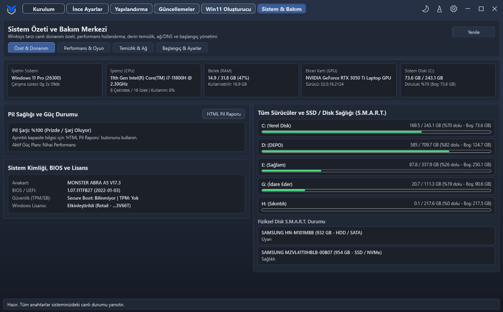
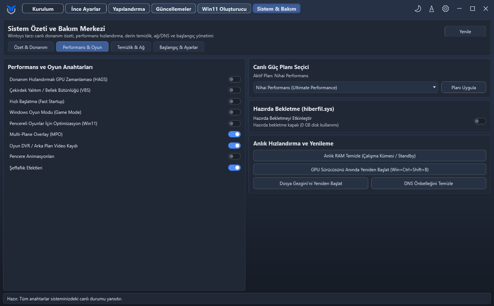
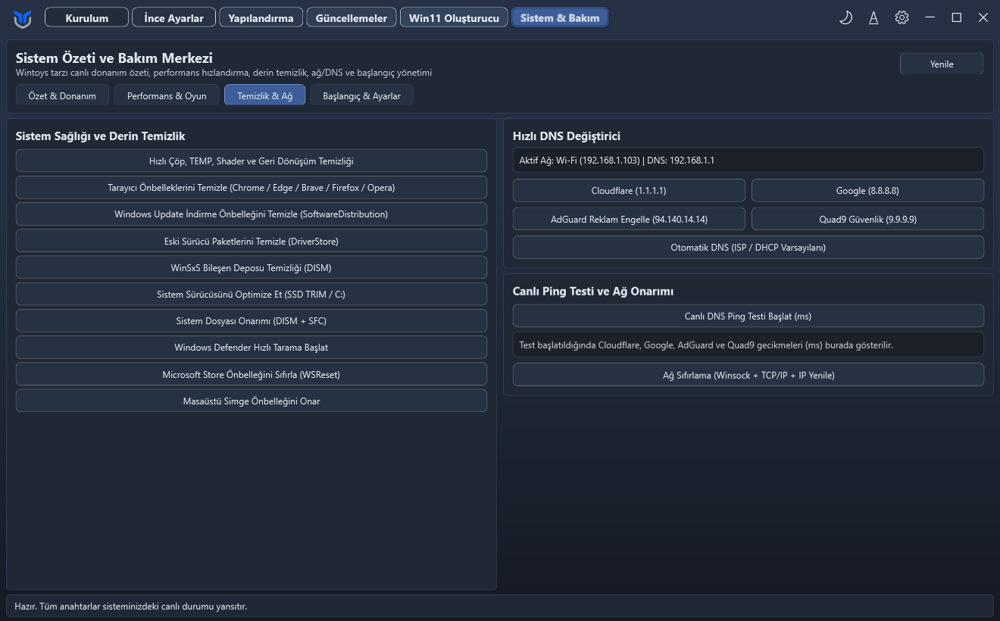
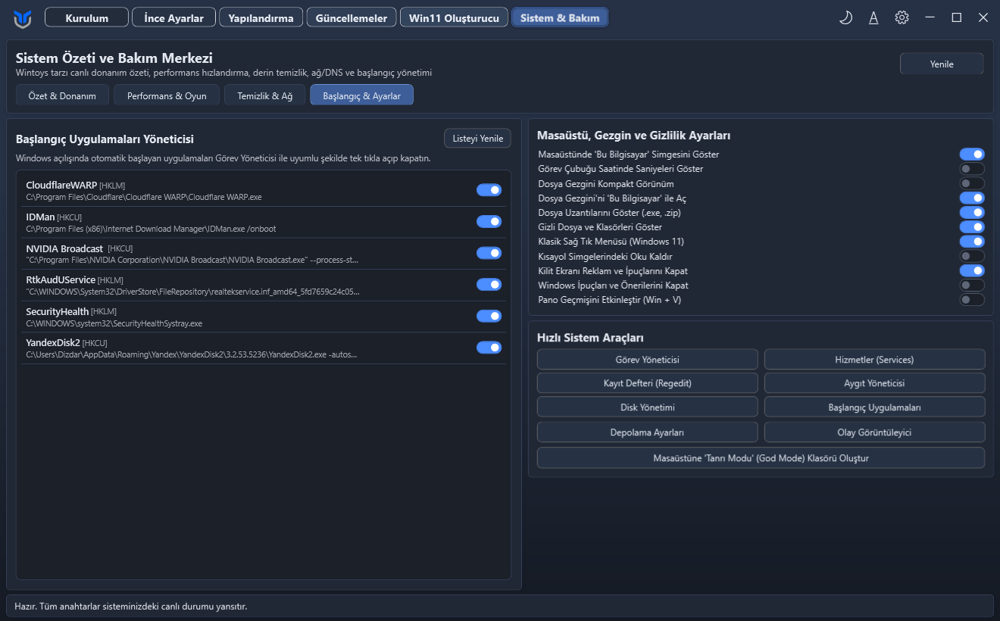

[🏠 Ana Sayfa](../README.md) · [📦 Kurulum](kurulum.md) · [⚙️ İnce Ayarlar](ince-ayarlar.md) · [🛠️ Yapılandırma & Güncellemeler](yapilandirma-ve-guncellemeler.md) · [💿 Win11 Oluşturucu](win11-olusturucu.md) · [🩺 Sistem & Bakım](sistem-ve-bakim.md) · [📱 AppX Yönetimi](appx-yonetimi.md) · [❓ SSS](sss.md)

# 🩺 Sistem & Bakım (Wintoys Tarzı Yönetim Merkezi) Rehberi

**Sistem & Bakım** (*System & Health*) sekmesi, popüler **Wintoys** aracının en sevilen özelliklerini 4 düzenli alt sekme altında doğrudan **WinUtil Türkçe** içine entegre eder:

1. **Özet & Donanım** — Canlı sistem kartları, pil sağlığı (HTML rapor), anakart/BIOS/TPM/lisans kimliği, tüm diskler ve S.M.A.R.T. sağlığı
2. **Performans & Oyun** — 9 canlı hızlandırma/oyun anahtarı, canlı güç planı seçici, `hiberfil.sys` yönetimi, anlık RAM temizleme ve GPU sürücü yenileme
3. **Temizlik & Ağ** — 10 derin temizlik ve bakım aracı (tarayıcı önbelleği, Windows Update, DriverStore, WinSxS, SSD TRIM, DISM+SFC, simge onarımı) + tek tıkla DNS değiştirici, canlı ping testi ve ağ sıfırlama
4. **Başlangıç & Ayarlar** — Görev Yöneticisi uyumlu canlı Başlangıç Uygulamaları Yöneticisi, 11 hızlı masaüstü/gezgin/gizlilik anahtarı, 8 sistem aracı ve tek tıkla **Tanrı Modu (God Mode)**

---

## 1. 📊 Özet & Donanım (Overview & Hardware)

- **5 Canlı Donanım Kartı:** İşletim Sistemi (sürüm/build/çalışma süresi), İşlemci (çekirdek/izlek/anlık yük), Bellek (kullanılan/toplam/boş GB), Ekran Kartı (fiziksel harici GPU öncelikli + sürücü sürümü) ve Sistem Diski (`C:`).
- **Pil Sağlığı ve Güç Durumu:** Dizüstü bilgisayarlarda tasarım kapasitesi vs. güncel tam şarj kapasitesini okuyarak **Pil Sağlığı (%)**, şarj durumu, döngü sayısı ve aktif güç planını gösterir. **HTML Pil Raporu** butonu `powercfg /batteryreport` raporunu oluşturup tarayıcıda açar.
- **Sistem Kimliği, BIOS ve Lisans:** Anakart üreticisi/modeli, BIOS/UEFI sürümü ve tarihi, **Secure Boot + TPM** durumu ile Windows etkinleştirme ve lisans kanalı (*OEM / Retail / Volume*) özetini tek yerde sunar.
- **Tüm Sürücüler ve SSD / Disk Sağlığı (S.M.A.R.T.):** Sistemdeki tüm sabit disk bölümlerini (`C:`, `D:`, `E:`...) canlı doluluk çubuklarıyla listeler; fiziksel disklerin **S.M.A.R.T.** sağlık durumunu (*Sağlıklı / Uyarı*), sıcaklığını (°C) ve SSD aşınma yüzdesini gösterir.

---

## 2. ⚡ Performans & Oyun (Performance & Gaming)

### Performans ve Oyun Anahtarları (9 Canlı Anahtar)
Tüm anahtarlar bilgisayarınızın mevcut durumunu otomatik okur ve tıklandığında anında uygulanır:

| Ayar | Ne İşe Yarar? |
| :--- | :--- |
| **Donanım Hızlandırmalı GPU Zamanlaması (HAGS)** | Ekran kartı bellek yönetimini doğrudan GPU donanımına devrederek oyunlarda gecikmeyi azaltır *(yeniden başlatma gerektirir)*. |
| **Çekirdek Yalıtım / Bellek Bütünlüğü (VBS)** | Sanallaştırma tabanlı güvenliği kontrol eder. Güvenlik için açık kalır; yüksek FPS isteyen kullanıcılar kapatabilir *(yeniden başlatma gerektirir)*. |
| **Hızlı Başlatma (Fast Startup)** | Kapanışta çekirdek oturumunu kaydederek açılışı hızlandırır. Çift işletim sistemi (Linux/Windows dual-boot) kullananlar kapatmalıdır. |
| **Windows Oyun Modu (Game Mode)** | Oyun sırasında arka plan güncellemelerini ve bildirimleri sınırlar, CPU önceliğini oyuna yönlendirir. |
| **Pencereli Oyunlar İçin Optimizasyon (Win11)** | Pencereli ve çerçevesiz oyunlarda giriş gecikmesini (input lag) azaltır, VRR ve Auto HDR uyumluluğunu artırır. |
| **Multi-Plane Overlay (MPO)** | NVIDIA/AMD ekran kartlarında Alt+Tab veya video izlerken takılma/siyah ekran yaşıyorsanız kapatıp yeniden başlatmanız önerilir. |
| **Oyun DVR / Arka Plan Video Kaydı** | Xbox/Windows arka plan oyun kaydını kontrol eder; kapatılması oyunlarda FPS kararlılığını artırabilir. |
| **Pencere Animasyonları** | Kapatıldığında pencereler animasyon beklemeden anında açılıp kapanır ve sistem daha seri hissedilir. |
| **Şeffaflık Efektleri** | Görev çubuğu ve menülerdeki yarı saydamlık efektlerini açar/kapatır. |

### Güç Planı, Hazırda Bekletme ve Anlık Hızlandırma
- **Canlı Güç Planı Seçici:** *Dengeli*, *Yüksek Performans*, *Güç Tasarrufu* ve *Nihai Performans* planları arasında tek tıkla geçiş yapar (eksik olan *Nihai Performans* planını otomatik ekler).
- **Hazırda Bekletme (`hiberfil.sys`):** Diskte genellikle 6–16 GB yer kaplayan `hiberfil.sys` dosyasının gerçek boyutunu gösterir; tek tıkla kapatıp yer açabilirsiniz.
- **Anlık RAM Temizle:** Arka plandaki gereksiz bellek çalışma kümelerini (*Working Sets*) boşaltıp kaç MB serbest kaldığını raporlar.
- **GPU Sürücüsünü Anında Yeniden Başlat:** Ekran donması veya görüntü takılmasında Microsoft'un resmi `Win+Ctrl+Shift+B` sürücü yenileme kısayolunu tek tıkla tetikler.
- **Dosya Gezgini'ni Yeniden Başlat** ve **DNS Önbelleğini Temizle**.

---

## 3. 🧹 Temizlik & Ağ (Cleanup & Network)

### Sistem Sağlığı ve Derin Temizlik (10 İşlem)
| İşlem | Ne Yapar? |
| :--- | :--- |
| **Hızlı Çöp, TEMP, Shader ve Geri Dönüşüm Temizliği** | Kullanıcı ve sistem `TEMP`, DirectX/NVIDIA/AMD Shader önbellekleri, Prefetch ve Geri Dönüşüm Kutusu'nu temizler; açılan alanı MB cinsinden bildirir. |
| **Tarayıcı Önbelleklerini Temizle** | Chrome, Edge, Brave, Vivaldi, Opera / Opera GX ve Firefox önbelleklerini temizler — **şifrelerinize, yer imlerinize ve açık oturumlarınıza kesinlikle dokunmaz**. |
| **Windows Update İndirme Önbelleğini Temizle** | `wuauserv`/`bits` hizmetlerini geçici durdurup `SoftwareDistribution\Download` klasöründeki eski güncelleme artıklarını güvenle siler. |
| **Eski Sürücü Paketlerini Temizle (`DriverStore`)** | `pnputil` ile aynı donanımın artık kullanılmayan eski sürücü kopyalarını güvenle kaldırır *(kullanımda olan aktif sürücülere dokunmaz)*. |
| **WinSxS Bileşen Deposu Temizliği (DISM)** | `DISM /StartComponentCleanup` ile eski Windows güncelleme bileşenlerini temizler. |
| **Sistem Sürücüsünü Optimize Et (SSD TRIM / C:)** | SSD disklerde TRIM, HDD disklerde birleştirme çalıştırır. |
| **Sistem Dosyası Onarımı (DISM + SFC)** | Bozuk Windows sistem dosyalarını tarayıp onarır. |
| **Windows Defender Hızlı Tarama Başlat** | Yerleşik Defender ile hızlı zararlı yazılım taraması başlatır. |
| **Microsoft Store Önbelleğini Sıfırla (`WSReset`)** | Store açılmama ve indirme takılma hatalarını giderir. |
| **Masaüstü Simge Önbelleğini Onar** | Bozuk veya beyaz görünen uygulama simgelerini önbelleği yeniden oluşturarak düzeltir. |

### Hızlı DNS Değiştirici, Canlı Ping ve Ağ Onarımı
- **Aktif Bağlantı ve DNS Göstergesi:** Aktif ağ bağdaştırıcınızı, IPv4 adresinizi ve mevcut DNS sunucularınızı canlı gösterir.
- **Tek Tıkla DNS Profilleri:** **Cloudflare (`1.1.1.1`)**, **Google (`8.8.8.8`)**, **AdGuard Reklam Engelle (`94.140.14.14`)**, **Quad9 Güvenlik (`9.9.9.9`)** ve **Otomatik DNS (ISP/DHCP)**.
- **Canlı DNS Ping Testi:** 4 DNS sağlayıcısının gecikmesini (ms) ölçüp bilgisayarınız için **en hızlı sunucuyu** gösterir.
- **Ağ Sıfırlama:** Winsock, TCP/IP yığını ve DNS önbelleğini tek tıkla sıfırlar.

---

## 4. 🚀 Başlangıç & Ayarlar (Startup & Tweaks)

### Başlangıç Uygulamaları Yöneticisi
- `HKCU\Run`, `HKLM\Run`, `WOW6432Node\Run` ve Başlangıç klasöründeki tüm otomatik başlayan uygulamaları canlı listeler.
- Yanındaki anahtarla tek tıkla **Aç / Kapat** yapabilirsiniz. Windows Görev Yöneticisi'nin kendi resmi `StartupApproved` anahtarını kullandığı için **%100 güvenli ve geri alınabilirdir** (uygulamaları silmez, yalnızca başlangıç iznini değiştirir).

### Masaüstü, Dosya Gezgini ve Gizlilik Ayarları (11 Canlı Anahtar)
- Masaüstünde **'Bu Bilgisayar' simgesini** göster / gizle
- Görev çubuğu saatinde **saniyeleri** göster / gizle
- Dosya Gezgini **Kompakt Görünüm**
- Dosya Gezgini'ni Hızlı Erişim yerine **'Bu Bilgisayar'** ile aç
- **Dosya uzantılarını** (`.exe`, `.zip`) göster
- **Gizli dosya ve klasörleri** göster
- **Klasik sağ tık menüsü** (Windows 11)
- Kısayol simgelerindeki **oku kaldır**
- **Kilit ekranı** reklam ve ipuçlarını kapat
- **Windows ipuçları** ve önerilerini kapat
- **Pano Geçmişini (`Win + V`)** etkinleştir / kapat

### Hızlı Sistem Araçları + Tanrı Modu (God Mode)
- Tek tıkla **Görev Yöneticisi**, **Hizmetler**, **Kayıt Defteri**, **Aygıt Yöneticisi**, **Disk Yönetimi**, **Başlangıç Uygulamaları**, **Depolama Ayarları** ve **Olay Görüntüleyici** açılır.
- **Masaüstüne 'Tanrı Modu' (God Mode) Klasörü Oluştur:** Tüm Windows yönetim ve Denetim Masası ayarlarını tek pencerede toplayan özel sistem klasörünü masaüstüne oluşturup açar.

---

[🏠 Ana Sayfa](../README.md) · [📦 Kurulum](kurulum.md) · [⚙️ İnce Ayarlar](ince-ayarlar.md) · [🛠️ Yapılandırma & Güncellemeler](yapilandirma-ve-guncellemeler.md) · [💿 Win11 Oluşturucu](win11-olusturucu.md) · [🩺 Sistem & Bakım](sistem-ve-bakim.md) · [📱 AppX Yönetimi](appx-yonetimi.md) · [❓ SSS](sss.md)
