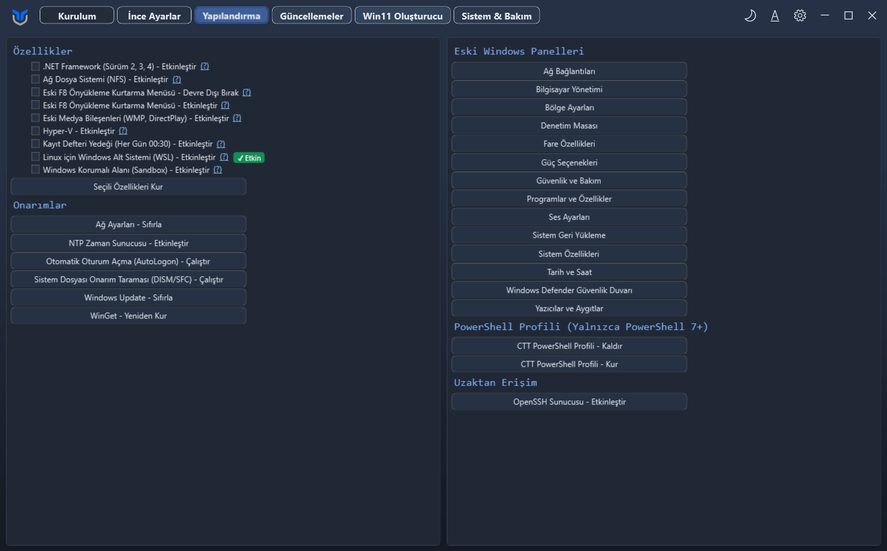
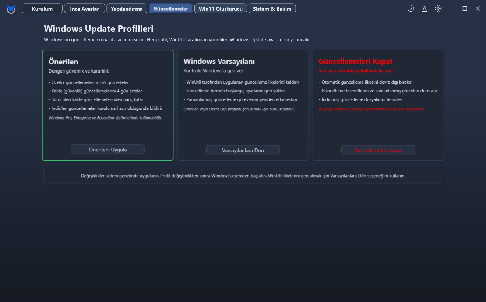

[🏠 Ana Sayfa](../README.md) · [📦 Kurulum](kurulum.md) · [⚙️ İnce Ayarlar](ince-ayarlar.md) · [🛠️ Yapılandırma & Güncellemeler](yapilandirma-ve-guncellemeler.md) · [💿 Win11 Oluşturucu](win11-olusturucu.md) · [🩺 Sistem & Bakım](sistem-ve-bakim.md) · [📱 AppX Yönetimi](appx-yonetimi.md) · [❓ SSS](sss.md)

# 🛠️ Yapılandırma ve 🔄 Güncellemeler Rehberi

## Bölüm 1: Yapılandırma (Config) Sekmesi

**Yapılandırma** sekmesi; isteğe bağlı Windows özelliklerini kurmak, sistem/ağ/güncelleme sorunlarını tek tıkla onarmak ve klasik Denetim Masası panellerine hızlıca erişmek için kullanılır.

> 🟢 **Otomatik Durum Tespiti:** Sekme açıldığında bilgisayarınızda zaten etkin olan Windows özellikleri (WSL, Hyper-V, .NET, Sandbox vb.) otomatik taranır ve yanlarında yeşil **`✓ Etkin`** rozeti gösterilir.

### Eski Windows Panelleri

| Öğe | Ne İşe Yarar? |
| :--- | :--- |
| **Ağ Bağlantıları** | Klasik Ağ Bağlantıları (`ncpa.cpl`) bağdaştırıcı listesini açar. |
| **Bilgisayar Yönetimi** | Klasik Windows Bilgisayar Yönetimi (`compmgmt.msc`) penceresini açar. |
| **Bölge Ayarları** | Klasik Bölge ve tarih biçimi (`intl.cpl`) ayarlarını açar. |
| **Denetim Masası** | Klasik Windows Denetim Masası'nı (`control`) açar. |
| **Fare Özellikleri** | Klasik Fare Özellikleri (`main.cpl`) penceresini açar. |
| **Güvenlik ve Bakım** | Klasik Güvenlik ve Bakım (`wscui.cpl`) penceresini açar. |
| **Güç Seçenekleri** | Klasik Güç Seçenekleri (`powercfg.cpl`) penceresini açar. |
| **Programlar ve Özellikler** | Klasik Program Kaldır / Değiştir (`appwiz.cpl`) ekranını açar. |
| **Ses Ayarları** | Klasik Ses Aygıtları (`mmsys.cpl`) penceresini açar. |
| **Sistem Geri Yükleme** | Windows Sistem Geri Yükleme (`rstrui.exe`) sihirbazını açar. |
| **Sistem Özellikleri** | Klasik Sistem Özellikleri (`sysdm.cpl`) penceresini açar. |
| **Tarih ve Saat** | Klasik Tarih ve Saat (`timedate.cpl`) penceresini açar. |
| **Windows Defender Güvenlik Duvarı** | Windows Defender Güvenlik Duvarı (`firewall.cpl`) ekranını açar. |
| **Yazıcılar ve Aygıtlar** | Klasik Aygıtlar ve Yazıcılar penceresini açar. |

### Özellikler

| Öğe | Ne İşe Yarar? |
| :--- | :--- |
| **.NET Framework (Sürüm 2, 3, 4) - Etkinleştir** | .NET ve .NET Framework, farklı türde uygulamalar çalıştırmak ve geliştirmek için gerekli Microsoft altyapısıdır. |
| **Ağ Dosya Sistemi (NFS) - Etkinleştir** | Ağ üzerinden dosya depolama ve paylaşım için NFS istemci desteğini etkinleştirir. |
| **Eski F8 Önyükleme Kurtarma Menüsü - Devre Dışı Bırak** | Gelişmiş F8 önyükleme menüsünü kapatarak standart Windows önyükleme davranışına döner. |
| **Eski F8 Önyükleme Kurtarma Menüsü - Etkinleştir** | Başlangıçta F8 ile gelişmiş sorun giderme ve güvenli mod ekranına erişmenizi sağlar. |
| **Eski Medya Bileşenleri (WMP, DirectPlay) - Etkinleştir** | Eski Windows sürümlerine ait medya ve oyun bileşenlerini (Windows Media Player, DirectPlay) etkinleştirir. |
| **Hyper-V - Etkinleştir** | Hyper-V, Microsoft'un sanal makineler oluşturup yönetmenizi sağlayan donanım sanallaştırma özelliğidir. |
| **Kayıt Defteri Yedeği (Her Gün 00:30) - Etkinleştir** | Windows 10 1803 ile kapatılan günlük otomatik Kayıt Defteri (Registry) yedeklemesini yeniden etkinleştirir. |
| **Linux için Windows Alt Sistemi (WSL) - Etkinleştir** | Ayrı bir sanal makine veya çift önyükleme gerekmeden Linux programlarını doğrudan Windows üzerinde çalıştırmanızı sağlar. |
| **Seçili Özellikleri Kur** | Yukarıda işaretlediğiniz Windows özelliklerini (DISM üzerinden) kurar. |
| **Windows Korumalı Alanı (Sandbox) - Etkinleştir** | Uygulamaları yalıtılmış ve geçici bir masaüstü ortamında güvenle test etmenizi sağlayan hafif sanal makine. |

### Onarımlar

| Öğe | Ne İşe Yarar? |
| :--- | :--- |
| **Ağ Ayarları - Sıfırla** | Winsock, TCP/IP ve DNS önbelleğini sıfırlayarak internet/ağ bağlantı sorunlarını giderir. |
| **NTP Zaman Sunucusu - Etkinleştir** | Daha doğru ve güvenilir saat eşitlemesi için varsayılan Windows NTP sunucusunu (time.windows.com) pool.ntp.org ile değiştirir. |
| **Otomatik Oturum Açma (AutoLogon) - Çalıştır** | Sysinternals AutoLogon aracını indirip çalıştırarak Windows açılışında şifresiz otomatik oturum açmayı yapılandırmanızı sağlar. |
| **Sistem Dosyası Onarım Taraması (DISM/SFC) - Çalıştır** | Bozuk Windows sistem dosyalarını bulup onarmak için `DISM /RestoreHealth` ve `sfc /scannow` taramalarını çalıştırır. |
| **Windows Update - Sıfırla** | Bozulan Windows Update bileşenlerini, hizmetlerini ve önbellek klasörlerini sıfırlayarak güncelleme hatalarını onarır. |
| **WinGet - Yeniden Kur** | Çalışmayan veya eksik olan WinGet paket yöneticisini yeniden kurar ve kaynaklarını sıfırlar. |

### PowerShell Profili (Yalnızca PowerShell 7+)

| Öğe | Ne İşe Yarar? |
| :--- | :--- |
| **CTT PowerShell Profili - Kaldır** | Kurulu CTT PowerShell profilini kaldırır. |
| **CTT PowerShell Profili - Kur** | PowerShell 7+ için renklendirme, otomatik tamamlama ve kullanışlı kısayollar içeren CTT PowerShell profilini kurar. |

### Uzaktan Erişim

| Öğe | Ne İşe Yarar? |
| :--- | :--- |
| **OpenSSH Sunucusu - Etkinleştir** | Bilgisayarınıza SSH ile uzaktan bağlanabilmeniz için Windows OpenSSH Sunucu hizmetini kurar ve etkinleştirir. |

---

## Bölüm 2: Güncellemeler (Updates) Sekmesi

**Güncellemeler** sekmesi, Windows Update davranışını tek tıkla üç hazır profilden birine geçirmenizi sağlar. Değişikliklerin tam olarak geçerli olması için profil seçtikten sonra **bilgisayarınızı yeniden başlatın**.

| Profil | Ne Yapar? | Kimler Seçmeli? |
| :--- | :--- | :--- |
| **Önerilen** *(Tavsiye Edilen)* | • Büyük özellik güncellemelerini (yeni Windows sürümleri) **365 gün** erteler. • Kalite ve güvenlik güncellemelerini olası hatalara karşı **4 gün** erteler. • Sürücü güncellemelerini Windows Update dışında bırakır. • Güncellemeler indirildiğinde kurulum öncesi bildirim verir. | Güvenliği kaybetmeden kararlı ve sorunsuz bir Windows isteyen **çoğu kullanıcı** *(Windows Pro, Enterprise ve Education sürümlerinde desteklenir)*. |
| **Windows Varsayılanı** | • WinUtil tarafından uygulanan tüm güncelleme ilkelerini temizler. • Windows Update hizmetlerini ve zamanlanmış görevlerini eski haline getirir. | Önceki profili geri almak veya Windows'un kendi varsayılan güncelleme düzenine dönmek isteyenler. |
| **Güncellemeleri Kapat** *(Dikkat!)* | • Otomatik güncelleme ilkesini devre dışı bırakır. • `BITS`, `wuauserv`, `UsoSvc` hizmetlerini ve zamanlanmış görevleri durdurur. • İndirilmiş güncelleme önbelleğini temizler. | ⚠️ **Yalnızca ileri düzey kullanıcılar / çevrimdışı test sistemleri.** Bu profil etkinken **güvenlik güncellemeleri yüklenmez**. |

---

[🏠 Ana Sayfa](../README.md) · [📦 Kurulum](kurulum.md) · [⚙️ İnce Ayarlar](ince-ayarlar.md) · [🛠️ Yapılandırma & Güncellemeler](yapilandirma-ve-guncellemeler.md) · [💿 Win11 Oluşturucu](win11-olusturucu.md) · [🩺 Sistem & Bakım](sistem-ve-bakim.md) · [📱 AppX Yönetimi](appx-yonetimi.md) · [❓ SSS](sss.md)
